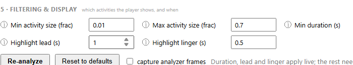
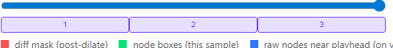
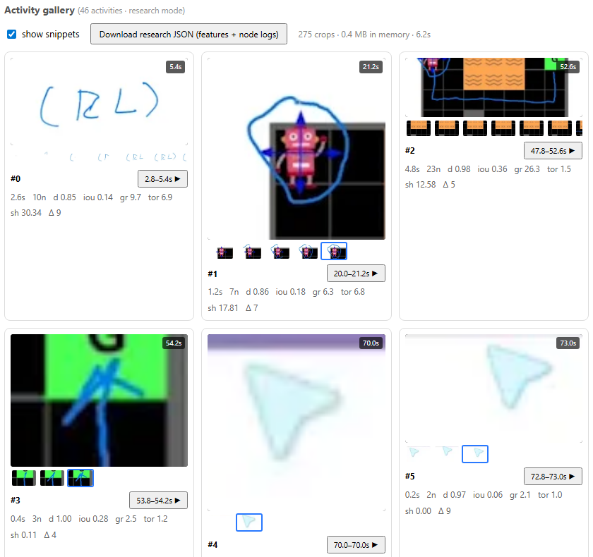

# Decisions

Every significant call, why it was made, and what we rejected. Newest concerns at the
bottom of each entry. If you are about to change one of these, read the "why" first — most
were made against a real constraint, and a few were made against a real bug.

---

## D1 — The analysis runs in the browser, not on a server

**Decision.** No backend. The video is loaded as an object URL and analyzed by a Web Worker
on the user's machine. The only network request is fetching the app itself.

**Why.** The pipeline is frame differencing and graph clustering — no ML model, no GPU
requirement. Once you notice that, the server stops earning its keep: it costs money, it
becomes a privacy liability (someone's unpublished lecture recording sitting on a disk),
and it adds an upload wait longer than the analysis itself. Client-side, the strongest
possible privacy claim is also the *literally true* one: the video never leaves the device.

**Consequences.** Deployment is a static site. There is no "analyze once, share the link"
without adding a backend later (the analysis JSON can be exported/imported instead). The
compute bill lands on the user's laptop, which is why performance is measured, not assumed
(see D6).

---

## D2 — No YouTube ingestion

**Decision.** v1 accepts local video files only. Pasting a YouTube link is not supported.

**Why.** Analysis needs the actual pixels. YouTube's embedded player is a cross-origin
iframe: you cannot read its frames, so you cannot analyze it, and you cannot magnify it
either (magnification needs `drawImage(video)` on a canvas). The only way to get the pixels
is to pull the stream (yt-dlp or equivalent), which is squarely against YouTube's Terms of
Service — and browsers can't do it anyway (no CORS headers on `googlevideo.com`), so it
would require a server proxy, i.e. a ToS violation *plus* the backend we just deleted.

**Rejected alternatives.**
- *Server-side download.* ToS violation. Also resurrects D1.
- *Client-side fetch of the stream.* Blocked by CORS, and still a ToS violation.

**Future option, if wanted.** `getDisplayMedia` tab capture: the user plays the video in
YouTube's own player and shares that tab. Playback stays inside YouTube's player, so it is
not "accessing content by other means" — the user is sharing their own screen. Clunky UX
(permission prompt, analysis runs at playback speed) and not built.

---

## D3 — Pure TypeScript pipeline, no OpenCV.js

**Decision.** The image operations (grayscale, absdiff, threshold, dilate, connected
components, moments) are ~200 lines of plain TypeScript in `analyzer/pipeline.ts`.
OpenCV.js is not a dependency.

**Why.** The original Python used exactly four OpenCV features: the frame-diff chain,
`findContours`, `matchShapes`, and (optionally) OCR. OCR is cut. `matchShapes`'s only
consumer was the activity **type** classification, which is also cut from v1 (see D8) —
so the one operation that genuinely needed OpenCV had no caller. Everything left is
element-wise arithmetic and a flood fill, and at 480p analysis resolution it is fast in
plain JS. OpenCV.js would have added ~8 MB of WASM to buy nothing.

*(We later reimplemented Hu moments by hand anyway — see D9 — which is the mathematical
core of `matchShapes`, about 40 lines.)*

---

## D4 — Mediabunny for demux + decode

**Decision.** Use [Mediabunny](https://github.com/Vanilagy/mediabunny) to demux the
container and drive WebCodecs, rather than hand-rolling it.

**Why.** This is the one part of the pipeline where hand-written code dies: container
parsing (MP4/WebM/MKV variants), codec configuration, and the "give me a frame at time *t*
without decoding the whole file" problem. Mediabunny's `samplesAtTimestamps()` does exactly
what the analyzer needs — an optimized monotonic decode that visits each packet once — and
hardware-accelerated decode is what makes the whole thing 10–20× realtime instead of 1×.

**Rejected.** `@doedja/scenecut-web` for scene detection (see D7): it demuxes and decodes
the video *itself*, meaning we would pay for decode twice. Decode is the expensive part;
everything else is a rounding error.

---

## D5 — Streaming analysis with watermark finalization

**Decision.** Analysis is a forward stream, not a batch job. Activities are emitted to the
player as soon as they can no longer change, and playback begins after a short analyzed
lead (10s) rather than waiting for the whole video.

**Why it's possible.** Look at the edge criterion in the original `roi.py`: two detection
nodes can only be connected if they are within `spanTh` (1s) of each other in time. There
is no criterion anywhere that spans the whole timeline. Therefore a cluster whose newest
node is older than `frontier − spanTh` **can never gain another member** — it is final, and
can be emitted immediately. This is the standard watermark pattern from stream processing,
and it falls straight out of the algorithm's own locality.

**Why it matters.** A 6-minute lecture at ~15× realtime still takes ~25 seconds to analyze
fully. Making the user watch a progress bar for 25 seconds before playback is a worse
product than starting in 3 seconds and racing ahead. It also bounds memory: only nodes
inside the `spanTh` window need to be held.

**Bonus.** This also kills the O(n²) graph build of the Python version by construction —
edge candidates are only the nodes in the current window.

---

## D6 — Performance is measured, never assumed

**Decision.** A ×-realtime meter is a first-class part of the app, not a debug afterthought.
Debug instrumentation is off by default (even in dev) so a development run measures the
same thing a production run does.

**Why.** The target users — low-vision learners — skew toward weak hardware (school-issued
Chromebooks, older laptops, often already running a screen magnifier). "It's fast on my
M-series MacBook" is not evidence. An early cross-model review flagged the throughput
assumption as the single riskiest thing in the plan, and it was right to.

**What we found.** On a dev laptop, 720p → 480p analysis runs at ~16–20× realtime. Debug
tooling itself is free (16.6× vs 16.7×); **frame capture** — the WebP encoding for the
analyzer view — costs **+51% wall time**. Any benchmark reading taken with capture on
understates the machine by ~35%.

**Still open.** The gating benchmark on genuinely low-end hardware has not been run. The
degradation path if it's slow is already parameterized (lower analysis width, longer sample
interval, or an "analyze first, then play" mode), so this is patchable, not architectural.

---

## D7 — Scene detection: how much changed, not how much the average pixel changed

**Decision.** Declare a cut when more than `sceneChangeFrac` (8%) of the frame changes between
two sampled frames — the occupancy of the diff mask we already compute.

**Superseded:** this used to be a port of PySceneDetect's `ContentDetector` (mean HSV
hue+saturation+luma delta per pixel, thresholded at 27). *It never fired on a real lecture.*

**Why the port failed, and why it took so long to notice.** `ContentDetector` is built for
film, where a cut replaces the whole frame and the mean delta spikes. A lecture deck is the
opposite case. Consecutive slides share a background, a header and a layout; only the text
differs. So a slide change moves perhaps a fifth of the pixels a very long way and leaves the
other four fifths **pixel-identical** — and averaging over all of them washes the signal out.

Measured on a 59-minute lecture: **every slide change scored under 2.5 against a threshold of
27.** The 7 cuts it did find were all in the first 17 minutes and were not slide changes at
all — they were the presenter dropping out of presentation mode to his desktop, which really
does replace the whole frame. Forty-three minutes of slides produced not one cut.

It went unnoticed because nothing downstream *depended* on scenes: the analyzer emitted them,
the debug scene strip drew them, and no user-facing feature read them. A detector that
silently returns nothing looks exactly like a video with no cuts. It only surfaced when the
moments sidebar tried to group by scene and got one group.

**Why occupancy works.** The same footage separates by an order of magnitude at each end:

| | share of frame changed |
|---|---|
| typical frame (writing, webcam) | 0.4% (median) |
| noise ceiling | 2.1% (p99) |
| **slide changes** | **20–30%** |
| cut to the desktop | 70%+ |

8% sits in the gap. It is also free: the mask is computed for change detection anyway, so this
is one pass over a byte array, no extra decode, and it let ~40 lines of HSV code (and the
matching GLSL) be deleted from the pixel pipeline.

**Calibration caveat.** The threshold was fitted to **one** lecture and sanity-checked against
a whiteboard recording (peak 0.68% changed → correctly no cuts). Unfamiliar footage may move
it. Verified by eye against the source frames: of the sampled cuts, all were real — including
a burst of four in nine seconds that turned out to be the lecturer genuinely flipping back and
forth between two slides.

**Why not a library.** Unchanged from the original decision: the only browser-side option,
`@doedja/scenecut-web`, does its own demux and decode — paying twice for the expensive step
(see D4). We already have the frames.

**The parity behavior that mattered.** In the Python version, frame pairs were generated
*per scene*, so no frame difference ever crossed a cut. We reproduce this: a cut's own frame
pair produces no detection nodes, and all open clusters are flushed at the boundary.
**Activities can never span a scene change.** On a 3-slide test video this is the difference
between one bogus activity smeared across all three slides and three correct ones — and it
was very likely part of the "results don't feel one-to-one with Python" that prompted the
investigation.

---

## D8 — Activity *type* classification is deferred

**Decision.** v1 does not classify activities as `pointing` / `marking` / `sketching` /
`animation` / `add_sub`. Activities are type-less; the player highlights and magnifies
them all the same way.

**Why.** The original classifier was a stack of hand-tuned thresholds on shape difference,
duration and aspect ratio (`RoIActivity._calc_type`) with a `TODO: Maybe improve type
recognition in the future` comment on it. The player never used `type` for anything the
viewer sees — only the research inspector colored by it. Cutting it removed the only
consumer of `matchShapes` (see D3) and cost nothing user-facing.

**The plan instead.** Capture the data a *learned* classifier would need, and revisit
(see D9 and [research-data.md](research-data.md)). An LLM or a clustering model over
activity features is a better answer than more thresholds.

---

## D9 — Capture ML-ready data now, because it is unrecoverable later

**Decision.** Three layers, deliberately separated:

| Layer | What | When |
|---|---|---|
| **A — Features** | ~14 aggregate numbers per activity (IoU, trajectory, growth, shape-consistency, density, intensity) | **Always on.** Cheap, tiny, useful today. |
| **B — Node logs** | Every detection node with bbox, mass, centroid, 7 Hu moments, change intensity | **Opt-in** (`?research=1`) |
| **C — Snippets** | Native-resolution image crops of each activity region | **Opt-in** (`?snippets=1` / toggle) |

**Why now.** Almost all of this exists *inside the flood fill* for a few microseconds and is
then thrown away when we keep only the bounding box. Computing it later means re-analyzing
the video — and the video may be gone (we don't store it). Whatever we don't capture at
analysis time is lost. Features and moments cost almost nothing to compute alongside the
work already being done.

**The privacy line.** Layers A and B are *derived measurements* — numbers about pixels.
Layer C is *pixels*: snippets are literal fragments of the video. That's a different
category, so:
- Snippets are **generated lazily on the client, for display only**, from the video file the
  user already has open.
- They are **never included in any export**, even in research mode. Exporting image data
  would need its own explicit consent, and is deliberately not built.
- The claim "we don't store your video" stays literally true.

*Research mode. Note that the two natural classes are already visible to the naked eye —
blue ink (writing/sketching) vs. translucent cursor arrows (pointing) — and their feature
vectors differ accordingly (`iou`, `gr`, `sh`). That's the signal a future classifier will
learn from.*

---

## D10 — Snippets are sequences, generated post-hoc in one decode pass

**Decision.** Each activity gets a **sequence** of native-resolution crops
(`before → start → every 0.5s → end`, capped at 12, fixed crop window), generated *after*
analysis by a dedicated worker doing **one monotonic decode pass** over all requested
timestamps.

**Why a sequence, not one frame.** A single crop shows what an activity ended up being; a
sequence shows *what kind of thing it was*. Writing accumulates ink; pointing stays static;
an animation changes without ink. That temporal signature is the discriminative signal — the
thing a learned classifier is supposed to pick up on ([D8](#d8--activity-type-classification-is-deferred)).
A "before" frame is included as the baseline: what the region looked like with nothing there.

**Why the crop window is fixed** (the activity's box, not each node's): same window every
frame means the frames are spatially registered, so the stroke visibly grows inside a stable
frame. Per-node crops would jitter and be useless to both a human and a model.

**Why post-hoc, not during analysis.** Capturing crops inside the analysis loop would slow
the thing we most want to protect, would only capture downscaled 480p frames, and would run
even when nobody looks at them. Post-hoc costs analysis **nothing**, gives **native
resolution**, and only runs when snippets are on.

**Why a worker and not `<video>` seeks.** The obvious post-hoc implementation seeks a hidden
`<video>` once per crop. That's ~275 random seeks for a 5-minute lecture, each flushing the
decoder — minutes of work, and far worse on a long lecture. Instead we collect every
timestamp across all activities, sort them, and run **one** `samplesAtTimestamps()` pass
(the same optimized path the analyzer uses; each packet decoded at most once), cropping every
activity that needs a given frame from that single decode.

Measured: **275 crops in ~5 s, 0.4 MB** on the 5:32 RL lecture.

---

## D11 — The player was ported with fixes, not copied

**Decision.** The study player (VideoPlayer, HighlightIndicator, MagnificationOverlay, both
settings suites) was carried across, but reviewed on the way in.

**Why.** It was study code: it worked well enough to run an experiment. That is a lower bar
than "runs on a stranger's Chromebook". The review found real bugs — most notably a
per-frame video→canvas readback that ran **forever, even when the magnifier was invisible**,
taxing every second of playback on precisely the hardware we're worried about.

Full list in [porting-notes.md](porting-notes.md).

---

## D12 — Segment-based analysis, so seeking always wins

**Decision.** Analysis coverage is a **set of ranges**, not a single frontier. Seeking into
unanalyzed video makes the worker abandon its current segment and restart at the viewer's
position; when a segment runs into already-analyzed video, the worker backfills the earliest
remaining gap.

**Why.** With a single forward pass, seeking ahead put the viewer somewhere the analyzer
wouldn't reach for minutes, with no highlights and no way to hurry it. The viewer's position
is the only thing that matters in the moment, so it preempts everything.

**Accepted cost.** Each segment is independent (fresh clusterer, its start treated as a
scene start), so an activity straddling a segment boundary can appear as two. This is
cosmetic and only at a boundary the user themselves created by seeking. Stitching is
possible (the edge rule is local) but not built.

**A bug this design produced, and its fix.** A segment stopping at an already-analyzed
boundary left behind a sliver shorter than one sample interval; the gap-filler then re-picked
that sliver forever without ever producing a sample — the worker hung at "analyzing" and
never finished. Segments now claim coverage right up to the boundary, plus a no-progress
guard. Worth knowing about if you touch `ranges.ts`.

---

## D16 — Webcam suppression is a pre-pass, not streaming accumulation

**Decision.** The talking-head inset is located *before* analysis starts, by diffing ~24
frames sampled minutes apart (`pipeline.ts: webcamZone`), and detections inside the zone are
dropped at detection time. A streaming approach — accumulating a global churn map during
analysis and vetoing retroactively — was designed first and rejected.

**Why the existing veto wasn't enough.** The per-pixel occupancy veto (D-adjacent to
`persistFrac`) judges pixels individually. The inset's *rim* — silhouette edges that move
only when the head does — churns too rarely per-pixel to trip it. Measured on a 59-minute
lecture with a corner webcam: **171 of 602 valid moments were the webcam** (the veto caught
79); the leaked ones showed `flaggedFrac` 0–0.37 against the 0.5 threshold, exactly the rim
signature. The veto is also per-segment, so every seek/backfill re-learns the webcam blind.

**Why pre-pass beats streaming accumulation.** Timing. A zone known before the first
activity exists means the veto happens *before clustering* — no webcam activity is ever
created, nothing is ever retracted, and the sidebar never shows a row that later vanishes.
The streaming design needed confidence gating ("the zone may tighten but not jump") and
retroactive invalidation, both of which are state machines with edge cases. The pre-pass is
24 sparse decodes: **1.5 s on a 59-minute video**, before playback unlocks.

**Why sparse sampling works at all.** A person in an inset has always moved between two
frames minutes apart → webcam pixels churn in ~every consecutive pair. Slide pixels change
only in pairs straddling a slide turn; ink only in pairs straddling its writing. The churn
heatmap (visible under `?debug=1`) shows the head silhouette at ~100% of pairs against
everything else far below. This is broadcast TV's logo/PiP detection trick inverted: find
what never stays, instead of what never changes.

**Why churn alone could not find the inset's EXTENT — and edges could.** The first,
churn-only zone was tight around the silhouette, and 110 user-facing moments still leaked
from the inset's quiet side — webcam background the person only occasionally leans into.
Reading churn levels off the heatmap: that quiet side sits at **0.13** of pairs while the
slide sits at **0.44**. The churn ordering is inverted — any threshold loose enough to take
the halo takes the slide first, so no flood can work. What separates them is not how often
they change but whether they are inside the inset's rectangle, and the rectangle's border
is a *persistent edge* (present in ~every sampled frame). So the pre-pass accumulates an
edge map alongside the churn map and grows the zone to the enclosing persistent-edge
rectangle — the original un-inverted TV-logo trick. Both signals were proposed at the
design stage; the measurement is what proved BOTH are needed: churn for the core (edges
alone can't tell the inset's border from the slide's border) and edges for the extent
(churn can't reach where the person rarely moves).

**Deliberate refusals.**
- A churn blob above ~20% of the frame is **not** a zone: a camera video of an instructor at
  a board looks exactly like a giant webcam, and vetoing where they write would be the worst
  possible behaviour. Verified: the whiteboard test video yields no zone.
- **No face detection.** It would work, but needs a model, and "no model, no training,
  nothing to download" is a load-bearing product claim (About dialog). Revisit only if the
  model-free signal fails on real footage.
- **No skin-colour heuristics.** Fragile across skin tones and lighting — an accessibility
  tool whose suppression works better for some instructors' skin than others is not shipping.

**Known limitation.** An inset present for only part of the video dilutes the pair-churn
signature below threshold (a 50%-of-video webcam changes in ~50% of pairs). The per-pixel
occupancy veto remains as the second line of defense for that case.

---

## D15 — Enhance filters run as WebGL shaders, not CSS/SVG filters

**Decision.** `EnhanceCanvas` and `MagnificationOverlay` render through a small WebGL
renderer (`glEnhance.ts`) that implements the enhance effects as fragment shaders. The
SVG filter defs remain, but only as the **fallback** when WebGL is unavailable.

**Why.** `sharpen` was visibly loading the CPU. Simple CSS filter *functions* (`contrast`,
`blur`) are GPU-accelerated, but a **reference filter** — `filter: url(#…)` — drops the
browser into its **software SVG-filter path**. `feConvolveMatrix` is a per-pixel 3×3
convolution executed on the CPU, and because the canvas beneath updates every frame, it was
re-run on every frame, forever. Same for the `feMorphology` in the "bolder ink" filters.

A fragment shader does the identical maths on the GPU in microseconds. Everything moved:
- `bold-dark` / `bold-light` → 3×3 min/max (erode/dilate) with the same contrast stretch and
  saturate, folded into one pass (the stretch is monotonic, so it commutes with min/max)
- `sharpen` → the same `[0 −1 0; −1 5 −1; 0 −1 0]` unsharp kernel
- `invert`, and the magnifier's `contrast` → point ops in the final pass

**The second win, independent of the GPU:** redraws are now driven by
`requestVideoFrameCallback` — once per **new video frame** — instead of
`requestAnimationFrame`. A 30 fps lecture on a 144 Hz display was being re-filtered 144×/s to
show 30 distinct images. It also stops entirely while the video is paused, where the old loop
kept running forever.

**Fallback.** No WebGL → the 2D canvas + `filter: url(#…)` path from D14, unchanged. The SVG
defs are still the reference implementation, and the shaders are written to match them.

**Not verified here:** the CPU saving was measured by the user on real hardware, not by us —
the headless Chromium used for automated checks runs software GL (it even logs *"GPU stall due
to ReadPixels"*), so any performance number taken there would be meaningless. What *is*
verified in the browser: WebGL is selected, no CSS filter is applied, and the shader output is
correct (an `invert` magnifier renders fully inverted).

---

## D14 — Enhance filters copy the video into a canvas instead of filtering the backdrop

**Decision.** The highlight's "enhance" filters no longer use `backdrop-filter: url(#…)`.
Both the highlight and the magnifier now draw the relevant video region into a canvas and
apply a **regular** `filter: url(#…)` to that canvas (`EnhanceCanvas.tsx`).

**Why.** `backdrop-filter: url(#svg-filter)` is **unsupported in Firefox *and* Safari**
([mdn/browser-compat-data#24110](https://github.com/mdn/browser-compat-data/issues/24110)),
and Firefox does not degrade gracefully — the element fails to render at all, appearing at
`opacity: 0` ([bugzilla 1787623](https://bugzilla.mozilla.org/show_bug.cgi?id=1787623)). So
the study player's highlight filters were broken for roughly a third of users, *destructively*.
The original README noted "Firefox has issues with feMorphology over backdrop-filter" and
worked around it in prose rather than in code.

The asymmetry that makes the fix easy: a **regular** `filter: url(#…)` works in every current
browser. `MagnificationOverlay` already relied on that (it filters a canvas), so the highlight
just adopts the same technique. One approach, both features, no browser caveats.

**Cost.** A per-frame `drawImage` of the highlighted region — but only while filters are
enabled *and* an activity is highlighted. Off by default, zero cost.

**Consequence.** The highlight's box no longer animates its geometry while an enhance filter
is on: the canvas holds a fixed crop of the video, so tweening the box it lives in would smear
it against the frame underneath. Opacity still fades.

**Also cleaned up here:**
- Filter names were `thicker` / `thicker-[dark]` — describing what they do to *pixels* rather
  than *when to use them*, and the `[...]` was fragile inside `url(#…)`. Now `bold-dark`
  ("Bolder ink" — thickens dark writing on a light slide), `bold-light` (same for dark slides),
  `sharpen`, `invert`, each with a hint in the UI.
- The magnifier's **"Sharpen" slider never sharpened anything** — it drove CSS `contrast()`,
  and its label printed `sharpness − 1`, so "1x" actually meant contrast 2. Renamed to
  **Contrast** with an honest label. Real edge enhancement is now a separate `sharpen` filter
  (an `feConvolveMatrix` unsharp kernel).
- Unknown filter ids persisted from older builds are dropped on load (`sanitizeFilters`).

---

## D13 — Settings persist in localStorage

**Decision.** Highlight and magnification settings moved from `sessionStorage` (the study's
choice) to `localStorage`.

**Why.** In a study, every participant should start from identical defaults — sessionStorage
is correct there. For a real user, an accessibility configuration is *theirs*: a low-vision
learner who has tuned border width, fill opacity and zoom strength to their vision should
not have to redo it every visit. Different product, different default.

---

## D16 — Scenes are a global cut partition, not per-segment spans

**Decision.** The worker keeps one global list of content cuts and posts the full scene
partition (`{type:"scenes"}`, replace-not-append) whenever it changes. Activity ids are
assigned by the run, not by the per-segment clusterer, and App inserts streamed activities
in start order.

**Why.** Analysis is segmented — a seek abandons the current segment and restarts at the
playhead (D5). The old code posted each segment's span as a "scene" and let each segment's
clusterer restart ids at 0. On a straight run the two models coincide, so nothing looked
wrong. Under seek-spam they diverge violently: a cut-less 5.5-minute video produced 19
overlapping "scenes", false "Possible scene change" notices during playback, and 46
colliding activity ids — which React, keying sidebar rows by id, amplified into 84 rendered
rows for 39 real moments (28k duplicate-key errors) with permanently missing thumbnails.
A segment boundary is a coverage artifact; only a content cut is a scene boundary.

**How.** `addCut(t)` dedupes within `sceneMinLen` (two segments can rediscover the same cut
with fresh local debounce state), sorts, and re-posts the partition `[0, …cuts, duration]`.
The partition is also posted at `done`, so a cut-less video still ends with its single
whole-lecture scene. The player tracks the current scene by `start` rather than `id` —
partition ids shift by one when a backfilled segment finds an earlier cut, and an id
changing under a stationary playhead is not a scene change.

**Rejected.** Reconciling per-segment scene spans on the App side (merge overlaps, dedupe):
treats the symptom; the worker still emits records that are not scenes. Keeping per-clusterer
ids with a segment offset: still collides after any out-of-order flush.

**Limitation.** A cut lying exactly on a segment boundary is invisible (neither segment
diffs across it) — pre-existing, unchanged by this.

---

## D17 — The five persona features (July 2026 deliberation)

**Decision.** Five personas (low-vision learner — final word on conflicts, instructor,
sighted learner, blind learner, content creator) each used the app and proposed four
features; twenty proposals were debated on user value, feasibility, and architectural fit
and converged into five. Everything excluded is preserved with rationale in
proposals-parked.md — parked, not discarded.

The five, and the convergences that chose them:

1. **Pinned snapshot** (low-vision #1 + sighted #4): pin a magnified crop of a moment's
   finished ink over the playing video; sidebar thumbnails enlarge on demand. The core
   user's top need — "give me time to READ it" — and the crammer's "let me read the final
   board state" are the same artifact.
2. **Study pace** (low-vision #2 + sighted #1 + sighted #2 + blind #3): a playback-speed
   control, plus a moment-aware tempo mode with two directions on one engine — wait (pause
   at each moment's end; the blind learner's audio-scoped playback and the low-vision
   "don't outrun me") and skim (jump the gaps; measured 67% of a real lecture is
   moment-free dead air).
3. **Moments file** (instructor #1 + creator #2 + sighted #3 + blind #4 + creator #1):
   serialize the analysis once, spend it three ways — an IndexedDB cache keyed by file
   fingerprint (auto-restore on reopen), an exportable/importable .veasyguide.json sidecar
   (analyze once, share with 300 students; the architecture-honest answer to "embed it"),
   and a Markdown export (the blind learner's notes skeleton, the creator's pacing data).
4. **Spatial descriptions** (blind #2 + instructor #3): word the geometry the analyzer
   already computes — "Writing · top right · large" from box + features — in sidebar
   labels, announcements, and exports. The blind persona's key finding: the data to
   describe moments in words exists today; it is only ever spent on paint.
5. **Visible magnifier** (creator #4 + low-vision #4): an on-screen zoom toggle with
   pressed state and a persistent "ON · 1.7×" chip, touch-reachable, plus a full-frame
   fallback when the zoom target is empty (the fullscreen black-screen trap). The app's
   core interaction was a keyboard-only toggle whose state was invisible to its core user.

**Why these five.** Every persona lands at least one direct win; the low-vision learner
(the product's reason to exist) lands her top two; the blind learner's honest verdict —
"every unit of added value is paint" — is answered with data, not paint (descriptions,
wait-mode playback, Markdown export); and nothing violates the client-side, no-upload,
no-account, offline-first promises. The instructor's biggest ask (parked-pen detection) is
deliberately NOT here: it is analyzer research with false-positive risk against the app's
"never highlight the wrong thing" promise, and it is parked with a cost estimate rather
than rushed.

---

## D18 — The moments file: one serialization, three consumers

**Decision.** A finished analysis serializes to a single JSON shape (`momentsFile.ts`,
`format: "veasyguide-moments"`, versioned): video identity (size + duration + frame size —
rename-proof; the name is carried for humans, never matched on), analyzer params, meta,
webcam zone, scenes, activities. It is consumed three ways: an IndexedDB cache keyed by
that identity (reopening a video restores instantly; newest 20 kept), an exportable /
importable sidecar (drop video + `.veasyguide.json` together on the landing to skip
analysis), and a Markdown export (scene-grouped, worded, timestamped moments with gaps
≥ 15 s called out).

**Why.** Four of five deliberation personas independently asked for some face of this:
no-cache re-analysis burned every reopen (~25 min for a 90-minute lecture, times 300
students for an instructor), and the analysis data had no accessible artifact. The sidecar
is the architecture-honest redesign of the parked "paste a link / embed" proposal: what the
creator hosts is a few kilobytes of coordinates; the video never moves (D1/D2 intact).

**Trust boundary.** A sidecar is an untrusted file from a forum. Parsing returns human
error STRINGS, not exceptions; a wrong or corrupt file degrades to a normal fresh analysis
with the reason shown in a dismissible strip — a bad import must never mean a broken player.
Matching is by file size at import (cheap, pre-demux); an explicit Re-analyze bypasses the
cache and overwrites it, so debug parameter runs stay fresh.

**Rejected.** localStorage (5–10 MB quota vs multi-MB activity lists); hashing file bytes
for identity (reading a 2 GB file to fingerprint it costs the time the cache exists to
save); CSV export (the JSON is the machine-readable form; Markdown is the human one).

---

## D19 — Moments are described by geometry, not by a guessed verb

**Decision.** The spatial description (`describe.ts`) says WHERE and HOW BIG only — "top
right, medium size". The verb tier shipped in D17 (Writing / Pointing / Motion, inferred
from `growth` and `meanConsecIoU`) is removed, along with `momentLabel`, which was left a
pure alias of `momentPlace`. Duration is unchanged: every call site already prints it from
`start`/`end`, so composing it into the description string would only double-speak it.

**Why.** The verb was wrong too often to earn its place. A confident wrong word costs more
than no word at all: the user who most needs the description is the one who cannot glance
at the frame to catch the error, so a mislabelled "Writing" is not noise, it is a false
statement they have to act on. Box geometry is measured; the verb was inferred from two
features that turned out not to separate the classes cleanly outside the calibration clips.
Size stays for the same reason location does — it is measured, not guessed.

**What this does not close.** Naming the act is still worth doing; it needs the analyzer
research parked in proposals-parked.md (activity clustering — what the `features` block was
always collected for), not a pair of hand-tuned thresholds. The removal note in
`describe.ts` records the thresholds tried, so the next attempt starts from the failure
rather than reinventing it.

---

## D20 — The pinned snapshot's corner and size belong to the reader

**Decision.** The pin panel gets two cycle buttons in its caption — size (small /
medium / large) and corner (top right → bottom right → bottom left → top left) — both
persisted in `ViewSettingsStore`. Corners reuse the vocabulary `momentPlace` speaks, so
the panel's position and the moments' descriptions agree on words. Persisted, because a
reader who needs it large needs it large on every video; re-enlarging it each time is the
tax this app exists to remove.

**Why cycles, not a picker.** A menu would open over the very video the panel is already
covering. One button each, and each label names where the next press lands ("Snapshot
size: medium. Change to large."), so the choice is knowable without sight and without
having to try it first. No new hotkeys: the buttons are in the tab order, and the
keyboard map is already dense.

**Rejected: `resize: both`.** Free, native, one line — and pointer-only. Unusable by
keyboard, which is precisely the audience. Laziness that excludes the user is not
laziness, it is a bug.

**Two layout facts the browser had to teach us.** (1) `max-width` did nothing: the panel
is absolutely positioned, so it shrink-to-fits its image, and any crop narrower than the
cap made all three sizes render identically — the control was inert for every ordinary
moment. The size classes set `width`. (2) The control bar is z-50 and the panel is z-35,
so a tall panel grew UNDER the bar and the bar swallowed the panel's own caption
controls. The panel's height is now capped at the space the measured bar leaves
(`calc(100% - barHeight - 24px)`), the same trick the fullscreen moments overlay uses,
with the image shrinking (`min-height: 0`) rather than pushing the caption out of reach.
Verified across all 12 size×corner combinations: each clears the bar, stays in the
viewport, and keeps every button hittable.

---

## D21 — A pin holds the moment you pinned; it does not follow the lecture

**Decision.** While the pin panel is open, a newly finished moment no longer replaces its
contents. The panel shows what you pinned until you dismiss it or pin again (dismiss +
pin, or P twice, gives you the latest). Captures keep accruing in the background exactly
as before, so pinning between moments still shows the ink that just finished.

**Why.** The panel's whole reason to exist, from the low-vision persona's #1 need in D17,
is "give me time to READ it" — the reader takes their time while the lecture takes its
own. Following the newest capture handed the instructor's pace straight back: pin
something, and the lecture rolling on would swap it out from under you mid-read, caption
and all. The feature was quietly cancelling itself. Auto-follow was never a decision, it
was a default nobody questioned; D17's own wording called for the opposite.

**Cost, accepted.** There is no longer a "live latest writing" panel. Nobody asked for
one; the sidebar and the now-line already say what is happening now, and both track
playback. The pin is the one surface whose job is to NOT track playback.

**Why it was a five-line deletion.** The object-URL ownership guards this needed were
already in place from the original implementation: each new capture revokes the previous
one unless the pin owns it, and dismissing revokes the pin's url only when it is no longer
the latest. Once a pin outlives the newest capture, exactly one of the two owns each url.
Verified live: a pin held across 12 s and several moment-ends with its image intact
(naturalWidth 250, not broken), and dismiss + re-pin correctly jumped to the newest.

---

## D22 — The notes export lists every moment, including the ones the player won't show

**Decision.** `momentsMarkdown` lists all activities, each marked shown or not, with the
reason: `size outside the range the analyzer accepts` (the analyzer's own `isValid`
verdict) or `shorter than the ${minDuration}s minimum` (the display floor). The header
counts both ("3 moments · 2 found but not shown"). Gaps are measured between SHOWN moments
and renamed "no moments" from "no visual activity".

**Why.** Two things were wrong, and they pulled in opposite directions. The export filtered
on `isValid` alone while the player shows `isValid && duration >= minDuration`
(select.ts `validActivities`) — so the notes listed moments the sidebar does not, and a
note-taker comparing the two would find entries that don't exist in the app. And it dropped
rejected activities silently, so a creator asking "did it miss my pen stroke?" got a
shorter list rather than an answer. A file that says "not shown: size outside the range"
answers the question; a file that omits the line pretends there was nothing there.

**Ordering.** Entries carry their timestamp and are sorted, rather than pushed as
encountered. A gap is only discovered when the next shown moment arrives, so emitting it
at that point printed it after the not-shown entries lying inside it — a document claiming
"no moments 00:14–01:10" underneath the two it had just listed at 00:40 and 00:50. This
was invisible while rejected moments were unlisted; listing them exposed it.

**Why "no moments", not "no visual activity".** A rejected blip is still something the
analyzer saw. Letting one close a gap would claim the screen was busy when the viewer had
nothing to follow; calling the stretch activity-free contradicts a not-shown entry printed
inside it. Gaps describe what the viewer gets; the not-shown entries say what was there
anyway.

**Trust boundary.** `params` is read as `f.params?.minDuration ?? 0` — `parseMomentsFile`
does not require the field, so a hand-edited sidecar must not crash the export it is being
read for (D18).

---

## D23 — A moments file can arrive at any time, and it asks before it lands

**Decision.** Drop a `.veasyguide.json` on its own, onto a video that is already open — even
one mid-analysis — and it takes over after a confirm. The video element, the file and the
viewer's playhead are untouched; only the analysis is replaced (`applySidecar`, which is
`hydrateFrom` plus the same reset the drop-both path does, minus everything about the
video). The whole player screen becomes a drop target while a file is over it.

**Why.** Before this, `loadFiles` was wired only to `<Landing>`, which unmounts the moment a
video loads — so there was no drop target at all on the player screen, and a dropped file
made the browser navigate away, losing the analysis outright (the same bug the Landing zone
was written to fix, on the screen with more to lose). A sidecar alone was answered with
"drop it together with its video", which asked a viewer who had just realised a classmate
sent them the file to throw away what they were watching in order to save time. Nobody
takes that trade. The common case IS mid-analysis: that is when the file is worth most.

**Why confirm.** Applying discards an analysis the viewer may have waited twenty minutes
for. Cancel is autofocused and is what Esc and the backdrop both do — the risk is
destroying that work with a stray Enter, not the cost of one more click. The wording names
the actual cost, which differs by state: mid-analysis you stop waiting; finished, you
replace a complete run.

**The veil is the drop target, not the shell.** `dragleave` on a container fires every time
the pointer crosses a child boundary, so the flag would flicker. A veil covering everything
is the one element whose `dragleave` means "actually left"; its card is
`pointer-events: none` for the same reason.

**A native `<dialog>`**, like About: `showModal()` brings focus trapping, Esc and a backdrop.
A confirm that can be tabbed behind is worse than no confirm.

**Caught in review.** The dialog first counted `activities.filter(isValid)` and said "26
moments" where the sidebar showed 20 — the same drift D22 had just fixed in the notes
export, reintroduced within the hour. It now calls `validActivities`, which is the one place
that owns the rule. A confirm that misstates what you are about to get is worse than none.
The mismatch notice says "Nothing changed" rather than naming a state ("still analyzing")
that is wrong half the time it fires.

---

## D24 — Speed becomes an icon menu; Pace is removed

**Decision.** The control bar's two `<select>`s are gone. Speed is an icon that opens its
rates in a menu, showing the rate beside the icon only when it is not 1×. Pace — the
moment-aware tempo engine (continue / pause-after-each-moment / skip-to-next) — is removed
entirely: the select, the engine in the per-time update, `tempoActedRef`, and
`atMomentEnd` / `MomentEndBehavior` / `setAtMomentEnd` from `ViewSettingsStore`.

**Why.** The bar had run out of room. Two labelled selects, each sized to its widest option
("Pause after each moment"), spent roughly a third of the bar's width on every frame to
advertise two settings. Speed now costs 44px idle.

**The cost, stated plainly.** D17 records the tempo engine as the convergence of four of
five personas — the low-vision "don't outrun me", the blind learner's audio-scoped
playback, and the crammer's skim over a measured 67% of moment-free dead air. Removing it
removes all of that. This was the owner's call with that history in view; it is recorded
here so the next person reads a decision, not an oversight. `[` / `]` (previous / next
moment) still serve the skim case by hand.

**What was lost with the `<select>`.** The old code chose native selects deliberately:
"keyboard and screen-reader behavior come built in, and the bar is the one place a popup
must never fight the video." Mantine's Menu carries the roles, arrow keys, Escape and focus
return, but the native mobile picker and the select's "1×, 3 of 7" announcement are gone
for real. The trigger's `aria-label` carries the current rate instead, and `Shift+<` /
`Shift+>` are untouched.

**`withinPortal={false}` is load-bearing.** Portalled to `<body>`, the dropdown is invisible
in fullscreen — the same reason the Appearance popover sets it. Verified open inside the
fullscreen element.

**The rate is visible when off-default.** Icon-only at every rate would hide a setting that
silently changes how the whole lecture plays — the exact bug the visible-magnifier work
already fixed once ("keyboard-only, state invisible"). At 1× it is a bare icon; off-default
it goes amber with the rate, the same state language as the magnifier toggle and the NOW
mark.

---

## D25 — The typecheck was checking nothing, and it was hiding a dead feature

**What was wrong.** The root `tsconfig.json` is solution-style (`"files": []` plus
references), so `tsc --noEmit` against it checks **zero files**; only `tsc -b` follows
project references. `npm run build` (`tsc -b && vite build`) had been exiting 2 on 11
pre-existing errors, so the build script was red and the errors sat unread.

**The real bug it was hiding.** `ActivityGallery` posted `{type:"start", file, reqs}` to the
snippet worker, which only handles `open` and `batch`. The message matched no branch and was
dropped in silence: the research gallery has been generating **zero** snippets. It also
listened for `progress` and `done`, neither of which exists — the worker sends `batchDone` —
so its readout sat at "generating snippets… 0/599 frames" forever and its stats line could
never render. Measured before/after on a 170 s clip: 0 → 749 crops, and the frozen counter
became "599 crops · 1.8 MB in memory · 3.6s".

**Why TypeScript could not save us.** `Worker.postMessage` takes `any`. The outbound half of
the protocol was typed (`MessageEvent<SnippetOutMsg>`) and duly produced 7 errors narrowing
to `never` — the inbound half was not, so the `start`/`open` drift was invisible. The
gallery now sends through `const send = (m: SnippetInMsg) => worker.postMessage(m)`, which
is the whole fix: a typed door the compiler can watch.

**Ordering moved into the worker.** `open` must precede `batch`, and that was the caller's
job by convention — a contract no caller can keep, because there is no ack to wait for. An
`async` onmessage does not serialize: `batch`'s handler starts the moment `open`'s first
await yields. App.tsx got away with it only because its two posts sit in different effects
with real time between them. The worker now chains messages through a promise, so the order
holds for every caller.

**The other three.** `momentsFile.ts` imported `Range` unused. `App.tsx` (×2) hit the same
narrowing wall documented in D23: `parseMomentsFile`'s union discriminates on `error:
string`, and a non-literal type cannot narrow it, so `parsed.file` stays possibly-undefined
however you check — destructuring narrows. `ViewSettingsStore` inferred `groupByScene: true`
as the literal `true`, so the persist initializer never type-checked against
`TViewSettings`; it is annotated now.

**Result.** `tsc -b` reports 0 errors and `npm run build` exits 0, for the first time on
this branch. Use `tsc -b`, never `tsc --noEmit`, in this repo.

---

## D26 — The highlight's border is measured on the screen, not in the video

**What was wrong.** `border_width` — the number the Appearance sheet displays as "10px" —
was multiplied by `scaleRatio`, the video-pixels-to-CSS-pixels conversion, and the whole
border-bearing element was then scaled again by the Size setting's `transform`. Measured in
a headless browser at `deviceScaleFactor: 1`, a configured 10px border was painted:

| Lecture, in a 960px-wide player | `scaleRatio` | Painted border |
|---|---:|---:|
| 1920×1080 | 0.5 | 5.25px |
| 1280×720 | 0.75 | 7.35px |
| 640×360 | 1.5 | 15.75px |
| 640×480 in a 320px player | 0.375 | 3.15px |

Same setting, same monitor, same window; five times the thickness, decided by which file
the viewer happened to open. The optional pulse swung it a further 25% three times per
moment. The pointer had the same defect, and the fixed circle's diameter came out quadratic
in the Size setting (`base_scale` was multiplied in *and* carried by the transform), so 50%
drew 13.75px, 100% drew 52.5px and 200% drew 205px.

**Decision.** Two coordinate spaces, named and kept apart in `player/indicatorMetrics.ts`.
The **box** is video-space: where the highlight sits and how much ink it covers must track
the lecture, or it stops sitting on the instructor's pen. The **decoration** — border,
pointer, fixed-circle diameter — is screen-space: it is not a property of the lecture, it is
what this viewer told us their eyes need. Ten means ten.

**Why no `transform: scale()` may sit between the border and the viewport.** Dropping
`* scaleRatio` is only half of it: a CSS transform scales everything the element paints,
borders included. Counter-scaling the declared width — asking for `10 / 1.05` so it lands at
10 — was tried and **measured to fail**: Blink floors a used `border-width` to a whole CSS
pixel, so `9.52px` is painted as `9px` and lands at 9.45. Only the structural rule holds. The
box is therefore centred with `translate: -50% -50%` (a translation, which moves the box
without touching what it paints) and sized with width/height, and `@keyframes pulse` grows
those lengths instead of a transform.

**And the ring is an inset `box-shadow`, not a `border`.** A border is part of the box, and
this is not. Under the global `box-sizing: border-box` a border eats the interior, and when
the box is narrower than two borders CSS refuses to go negative and grows the BOX instead —
measured: with a 12px setting, a 20.1px annotation and a 5.0px one both rendered as a 24px
square, losing the distinction between them and drifting off the ink while the enhance canvas
stayed where it was. An inset shadow is painted, not laid out: the box stays exactly the size
the activity says, a ring too thick for it simply fills it, and it follows `border-radius` so
the fixed circle still gets a round ring. Re-measured after the change: 20.14px and 5.03px,
with a 12px ring on both.

The one thing a `border` did that a shadow does not: survive forced-colors mode. Windows
High Contrast sets `box-shadow: none`, so the highlight would have lost its outline entirely
for the viewers most likely to be running it — measured, and then measured again with
`forced-color-adjust: none` on `.highlight-indicator`, which keeps the ring at 10px in both
modes. Opting out is the same contract the pulse has with `prefers-reduced-motion`: the
OS-wide preference sets the default, and this viewer went into the Appearance sheet and chose
these colours for their own vision. It is scoped to the mark; every other surface still
honours the OS.

Clamping the ring to fit a small box was rejected. It is the original bug wearing a different
hat: it makes 10 mean something else again, and it does so by way of the activity's size,
which is a video-space quantity.

**Cost.** The pulse is a layout animation now, not a compositor one. It is one absolutely
positioned element whose parent cannot resize, and it only runs when a viewer has gone and
switched the pulse on — which is off by default (see the Motion section of DESIGN.md).

**Why CSS pixels and not physical device pixels.** "Pixel-perfect with the monitor" has a
second reading that is a trap. Dividing by `devicePixelRatio` to reach hardware pixels would
make the border *thinner* on exactly the high-density screens where it is hardest to see, and
would shrink it when a low-vision viewer zooms in — the one action they take to make things
bigger. DESIGN.md commits to browser zoom as the magnification path for the same reason.

**The dynamic square's size stays a percentage of the wrapper**, not a baked pixel value:
the wrapper tweens its own width and height over 350ms when the highlight moves to the next
moment, and a percentage re-resolves against it every frame of that tween. Pixels computed at
render time would snap while the wrapper was still gliding, tearing the border off the box.

**Consequences.** Existing persisted settings keep their names and ranges but change meaning
— a stored `border_width: 10` now paints 10px where it used to paint 5. That is the point,
so there is no migration. The four presets were **not** retuned: their numbers are now honest,
and on a typical downscaled 1080p lecture every preset's border roughly doubles in apparent
thickness. `enhanceSource()` also derives the enhanced crop from the box's CSS extent rather
than from the analyzer rectangle, which fixes fixed-circle mode enhancing an activity-sized
rectangle underneath a 52px circle. Verified by `player/indicatorMetrics.test.ts` and by
measuring the real components in a headless browser at five video/player combinations, three
Size settings and four points on the pulse timeline: 10.0px in every one.

**Four bugs found while verifying this, since fixed.** Three predate D26; the fourth was
introduced while fixing the first, and is here because of how it was caught. All four surfaced
because measuring the pulse properly meant driving it in a browser.

*The pulse only ever ran once.* `animation: pulse ... forwards 3` reads as three throbs per
moment, and that is what the first moment got. But `selectActivity` hands one moment straight
to the next whenever they fall within lead+linger of each other — most of them, on a real
lecture — so the wrapper never unmounts, React reuses the element, and a finished CSS
animation does not restart because the styles around it changed. Measured: `pulse` sat
`finished` at t=3000ms and every subsequent moment was silent. The feature quietly stopped for
exactly the viewer who went and switched it on.

The fix rewinds rather than remounts, in an effect keyed on the moment: `key={currActivity.id}`
would restart the animations, but it would also tear down and rebuild `EnhanceCanvas` — a
fresh WebGL context per moment (`GLEnhancer.create`/`dispose`) on the weak hardware this app
is built for. Re-measured: `running` at t=117ms after a handover.

It rewinds in a `useLayoutEffect`. The hazard is a frame where the box has already moved to
the new moment while the throb is still at the old one's phase: hand over near the top of a
throb and that is a 25%-oversized box, on the one element whose job is to be the calm thing a
viewer can find. React explicitly permits the browser to paint before a passive effect runs,
so that frame is an allowed scheduling path.

Measuring it properly — box width sampled per frame, handover timed to land at the peak — did
**not** reproduce it: React flushed the passive version before paint in every run. (An earlier
phase-only measurement appeared to show the stale frame and did not; it was sampling before
React had committed, so the box was still the old one too, and D26 briefly claimed a flicker
on that basis. It is recorded here because "measured" and "measured the right thing" are not
the same claim.) A layout effect is the one that promises, and the promise costs one
`getAnimations` call.

The dependency list is deliberately narrow: the moment, an entry counter, whether the ink
canvas exists, and the ink's shape. Those are the edges that MOUNT a fresh animation at phase
zero against a border already mid-cycle. `animation_speed` is not one — both durations change
together and stay in phase on their own, while rewinding on it would snap the box back to rest
on every tick of a slider the viewer is dragging. The entry counter exists because the id
alone is not enough: leaving a moment and scrubbing back into it inside the 350ms fade-out
never unmounts the wrapper and never changes the id, so the returning highlight would arrive
with its throbs already spent.

*`getAnimations()` returns more than CSSAnimations.* The first version of that effect read
`.animationName` off everything the call returned. It also returns the wrapper's
`CSSTransitions` — the 350ms glide of left/top/width/height, which is running at precisely
that instant, because the highlight just moved. Transitions have no `animationName`, so this
threw inside an effect and took the player down on **every moment handover**. It never reached
a commit, but nothing in the unit suite could have seen it: it needed a real browser driving a
real handover. What the unit suite covers instead is `isThrobAnimation`, which is where the
decision now lives — fed a transition, an unnamed scripted animation, the wrapper's own fade,
and a same-family impostor.

*The ink and the border drifted apart.* `pulse` and `ink-spread` are two animations describing
one throb, and the clip only lines up with the ring if they share a phase. Switching an enhance
filter on mid-throb mounted a fresh canvas at phase zero against a border already 1117ms into
its cycle. Whether the ink canvas exists at all is a dependency of the rewind effect for that
reason — the canvas appearing, and the ink swapping between its square and round clips, are
the two edges that mount an animation at phase zero. Measured after: 83ms and 83ms.

*The pointer stood in the middle of the circle.* For the square the pointer's tip anchors to
the box's bottom-left corner and the hand hangs down and away. A circle has no corner there,
so anchoring to its bounding box's would have left the pointer floating in the empty quadrant
outside the disc — and the code compensated by translating it up by its own height, which on a
52.5px circle is 35px. That put the tip in the MIDDLE of the disc, with the hand covering the
one thing the circle had been drawn around. The honest analogue of a corner on a circle is the
point of its circumference facing the same way: 225 degrees, down and to the left. The tip
walks out from the centre by the radius less the usual overlap, along that diagonal, and the
`translate` is gone.

*The round mark had a square patch under it.* In fixed-circle mode the enhanced region was
the right size but clipped with `inset()`, so the four corners got bolder ink with nothing
pointing at them — worse than no enhancement, when the whole job of the mark is "look here".
`round 50%` on a square inset box is a circle, so the same 10%-to-0% inset drives it:
`inset(10% round 50%)` reveals a 52.8px circle against the ring's 52.5px at rest, and the full
66px against 65.625px at the peak. `clip-path: circle(50%)` covers the pulse being off, at 53px
against 52.5px. Those sub-pixel gaps are the enhance canvas rounding its backing store to whole
pixels (EnhanceCanvas.tsx) and are left alone: closing them would mean giving the canvas a CSS
size different from its bitmap size, which resamples a picture of the lecture to save a third
of a pixel.

---

## D27 — The enhance canvas is measured in device pixels, and the highlight moves under it

Three bugs the author found testing D26's work in the running app.

**The ink was not sitting 1:1 on the frame.** `EnhanceCanvas` set its bitmap to
`Math.round(width)` and gave it no CSS size, so the browser displayed it at the rounded width.
The crop is drawn to fill the whole canvas, which means every copied pixel was stretched by
`round(width) / width` — 0.57% on a 65.625px circle. Under half a pixel at the centre, but it
accumulates outward, so the edges of the enhanced patch slid off the writing they were copied
from. The same rounding left the ink clip revealing 52.8px inside a 52.5px ring.

The canvas is now sized twice, deliberately: its CSS box is the exact unrounded extent, and
its backing store is that box in **device** pixels. Measured before: 0.4px and 0.3px of
clip-versus-ring mismatch. After: 0.00px, at devicePixelRatio 1, 1.25, 1.5 and 2.

The backing-store half also fixes a HiDPI defect nobody had reported: a CSS-sized bitmap on a
150% or 200% display is upscaled by the compositor, so the enhanced patch was a *blurred* copy
of the lecture laid over the sharp original — the opposite of what an enhance filter is for.
The bold and sharpen kernels step one texel, so they now take a `pixelRatio` and scale that
step, or "one pixel of thickening" would have quietly become a third of a pixel on the
displays where it was already hardest to see.

**With a filter on, the highlight teleported.** The geometry transition was disabled whenever
an enhance canvas was showing, because the canvas holds a copy of the video from one position
and a CSS tween would slide that copy across the frame showing pixels borrowed from where the
box used to be. That traded a smear for a flinch, and a viewer tracking the mark across a
slide is exactly who loses it when it jumps.

It now tweens the **activity rectangle** instead of the CSS (`player/activityTween.ts`). The
wrapper's geometry, the box's size, the canvas's size and the canvas's source crop are all
derived from one rectangle, so interpolating that rectangle keeps all four in agreement by
construction — the copy is re-cut from the video every frame at wherever the box has got to.
Measured through a move: the crop stays locked to the box within 0.016 video px. The curve is
`cubic-bezier(0.42, 0, 0.58, 1)` solved by Newton, not approximated, so the mark travels
identically whether CSS or this is driving it — measured, the two agree to 0.1px per frame.
It costs a re-render per frame for 350ms, which is why it is only used when a filter is on.

**And then it jittered.** The first version started the journey in a passive effect. That left
one render — the render in which the moment changed — with no journey yet, so the geometry
fell through to the destination and the browser painted it there. Captured off a screencast of
actually-painted frames: `167 - 365 - 365 - 167 - 168 - 170 - 176 ...`. The mark appeared at
the far end for two frames, jumped back, and only then travelled.

Seeding progress 0 inside a `useLayoutEffect` fixes it, because the resulting re-render is
flushed before paint. Re-measured on painted frames: `167 - 167 - 170 - 176 - 181 - 190 ...`,
strictly monotonic, zero backward steps, in all three of square-with-ink, circle-with-ink and
the CSS path without. The journey also resumes from where the mark *is* rather than from the
moment it was heading for, so stepping quickly through moments does not send it back to
collect one it never reached.

The lesson worth keeping: `getBoundingClientRect()` inside a `requestAnimationFrame` callback
reported the destination for those two frames in BOTH paths, including the CSS one where the
browser never painted it. It cannot tell a committed style from a painted pixel. The screencast
could, and that is what caught this.

---

## D28 — The scene-change notice is the viewer's to switch off

**Decision.** "Possible scene change" — the pill that appears at the top of the video when
playback crosses a cut — is now a setting, `sceneNotice` in `ViewSettingsStore`, defaulting to
on. The control is a Notify/Quiet pair in the moments sidebar, next to the arrangement switch.

**Why it is in ViewSettingsStore and not HighlightSettingsStore.** A preset is a COMPLETE
snapshot of the highlight and magnification stores (D-note in presets.ts), applied wholesale.
A notice preference kept there would be switched back on the first time the viewer tried a
preset — by a control that says nothing about notices, and with no way to tell that is what
happened. The same reasoning already keeps `groupByScene` out of that store.

**Why the default is on.** It is a cue some viewers rely on to know the slide changed under
them, and turning it off by default would remove that from everyone to spare the people who
find it noisy. A feature that never appears is also one nobody discovers well enough to want
off.

**It is a switch in the footer, not a segmented pair in the header.** It shipped first as a
Notify/Quiet pair beside the arrangement switch. On/off is what this is, though, and a
segmented control renders both states as buttons — so a viewer has to read two words to work
out which one is current, where a switch says it by position. It also is not a control over
the rows above it; it is a standing preference about the video, which is why it sits under the
list rather than in a header already carrying the heading, the position readout, Export and
the arrangement switch. Mantine's `Switch` gives it `role="switch"` and wires the label to the
input, so pressing the words works.

**No description line under it.** There was one — "A pill at the top of the video when the
slide or camera cuts". Under 900px the sidebar is capped at 40vh, and three wrapped lines
pushed the footer past that cap, where the panel's `overflow: hidden` cut the switch off
entirely. Measured. The sentence moved to the `title`, which is a hint rather than the only
way to understand a control that already says what it does.

That cap also grew a floor: `max(40vh, 15rem)`. 40vh is a share of the WINDOW, and on a short
one it drops below what the panel's own fixed chrome needs — at 320x320 the switch vanished
outright. The floor is in rem so it grows with the reader's font size, and the page scrolls
normally around a taller panel, which is what an ordinary scrolling document is for.

**Gated in two places.** The trigger reads the store through `getState()` — it runs from the
frame loop, which outruns re-render — and the render gates the pill as well. Only doing the
first would leave a notice already on screen there for the rest of its 2500ms after the viewer
asked for quiet.

**Only when there is more than one scene**, matching the arrangement switch: with a single
scene there is no cut to cross, so the notice can never fire and the control would be a switch
for nothing.

**Not covered.** The "Analyzing this part…" cue is a different thing — it reports that the app
is not ready yet, rather than commenting on the lecture — and it stays unconditional.
